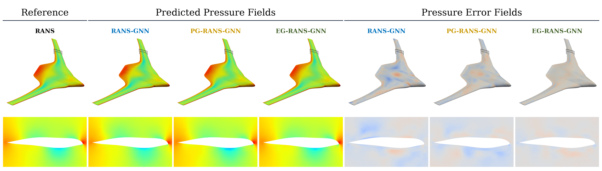
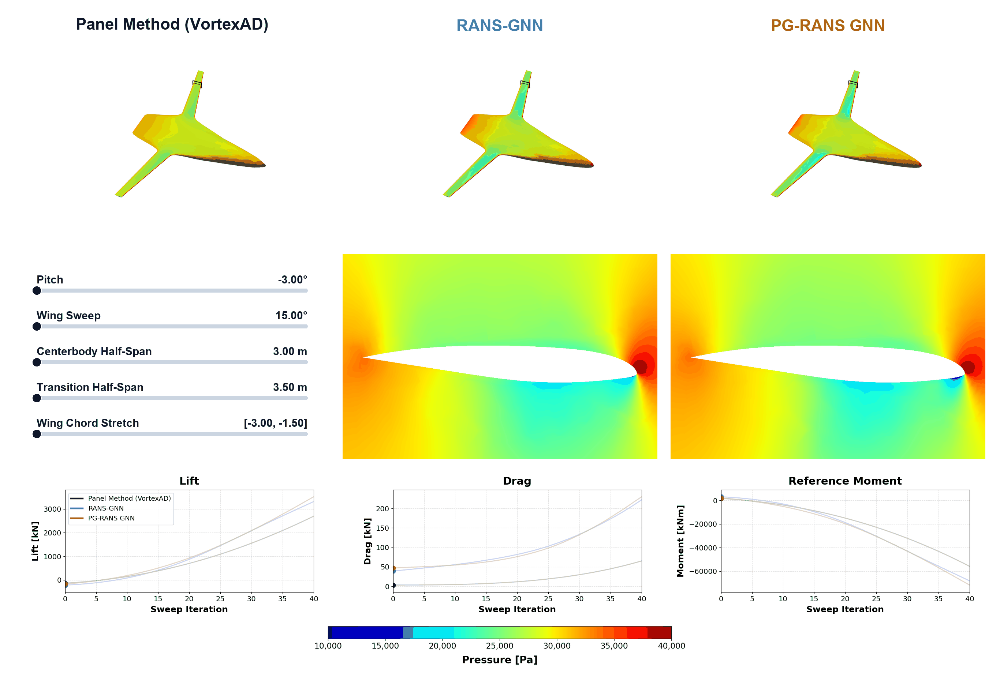

The development of this software was supported (, in part,) by the Air Force Research Laboratory through the Collaborative Center for the Design and Research Of InterDisciplinary Systems (CC DROIDS). Distribution Statement A: Approved for public release; distribution is unlimited. PA# AFRL-2026-2016. The authorized Git commit is identified in the corresponding GitHub release.

<!-- ## Reference -->
## **AeroDML** (Aerodynamic Deep Multifidelity Learning)

[](https://github.com/LSDOlab/AeroDML/actions/workflows/cpu-tests.yml)

This repository contains the RANS-GNN implementation associated with [Multifidelity Surrogate Modeling for 3D Aerodynamic Flow Field Prediction Using Graph Neural Networks](https://www.researchgate.net/publication/406026389_Multifidelity_Surrogate_Modeling_for_3D_Aerodynamic_Flow_Field_Prediction_Using_Graph_Neural_Networks).

AeroDML combines graph neural networks with optional panel-method or Euler
inputs to predict RANS flow fields for aircraft design. The application was
developed for HPC use on a blended-wing-body aircraft and can be adapted to
other configurations.



*Surface and cross-section pressure predictions and errors for the single-fidelity, panel-guided, and Euler-guided GNN models compared with RANS for a sample test case.*



*Geometry sweeps showing predicted surface pressure fields, cross sections, and aerodynamic coefficients across Panel Method (VortexAD), RANS-GNN, and PG-RANS GNN models.*

See the [documentation](https://lsdolab.github.io/AeroDML/) for the project
overview, package and model, data generation and training, and optimization.
The same pages are available in [docs/](docs/index.md).

## Tests

The badge above shows the current GitHub Actions CPU test status. To run the
suite locally from the repository root with the package installed:

```bash
JAX_PLATFORMS=cpu python -m unittest discover -s tests -v
```

These tests cover driver control flow, sample asset selection, and training
logging. See [tests/README.md](tests/README.md) for coverage and GPU smoke tests.

## Download release assets

Large data and model assets are distributed separately from the Git repository.

1. Clone or extract the matching source release.
2. Download **both** `aero-dml-assets-mesh.zip` and `aero-dml-assets-data.zip`,
   plus `SHA256SUMS`, from the same GitHub release. GitHub's automatic source ZIP
   does not contain these assets.
3. Place these downloads in the repository root and run:

```bash
cd AeroDML
sha256sum -c SHA256SUMS
unzip aero-dml-assets-mesh.zip
unzip aero-dml-assets-data.zip
python package_assets.py
```

Both ZIPs extract directly into repository-relative paths. They are independent
archives, not split-volume ZIPs; extract both, in either order. The final command
verifies all installed assets against the source release's manifest. Use a clean
checkout to avoid overwriting existing data. Always use code and assets from the
same release, even though the archive filenames are reused across releases.

## High-level workflow for a new geometry

The overall AeroDML workflow is:

```text
Parameterize geometry and prepare a reference CFD mesh
    -> sample geometry and flow configurations
    -> generate RANS and optional low-fidelity solutions
    -> check convergence and create dataset splits
    -> convert the common mesh topology into multilevel graphs
    -> train the GNN
    -> load the trained model and evaluate new cases
```

All cases in a dataset are expected to use the same mesh connectivity. Geometry changes should therefore be produced by deforming a common reference mesh rather than independently remeshing every case. The BWB implementation is the reference example to copy and adapt.

### 1. Define and parameterize the geometry

Create a geometry module that loads the baseline CAD model, defines its design variables, and returns the mapping from configuration names to geometry variables. Update the CFD wrapper so the reference OpenFOAM surface mesh can be projected onto the geometry and its volume mesh can be warped for each configuration.

Files to run or adapt:

- [`cases/datasets/BWB/bwb_geometry.py`](cases/datasets/BWB/bwb_geometry.py)
- [`cases/datasets/BWB/bwb_helper_functions.py`](cases/datasets/BWB/bwb_helper_functions.py)
- [`cases/datasets/BWB/bwb_cfd.py`](cases/datasets/BWB/bwb_cfd.py)
- The reference OpenFOAM case and CAD files distributed with the release assets

### 2. Define the dataset configurations

Choose ranges for the geometry parameters and flow conditions, then generate a `cases.json` file. Case `0` is the reference configuration and the remaining cases are Latin-hypercube samples within the specified ranges.

Files to run or adapt:

- [`cases/datasets/BWB/data/sample_dataset/build_configs.py`](cases/datasets/BWB/data/sample_dataset/build_configs.py)

### 3. Generate the high-fidelity CFD data

Run one RANS solve for every entry in `cases.json`. Each completed case is saved as an NPZ file containing the deformed mesh coordinates, cell-centered flow fields, forces, geometry configuration, flow conditions, and convergence status.

Files to run or adapt:

- [`cases/datasets/BWB/generate_rans_single.py`](cases/datasets/BWB/generate_rans_single.py)
- [`cases/datasets/BWB/batch_rans.sh`](cases/datasets/BWB/batch_rans.sh)

### 4. Optionally generate low-fidelity data

For multifidelity training, generate an Euler or panel-method solution for the same case identifiers used by the RANS dataset. These fields are mapped onto the RANS graph and used as a baseline that the GNN learns to correct.

Files to run or adapt:

- [`cases/datasets/BWB/generate_euler_single.py`](cases/datasets/BWB/generate_euler_single.py)
- [`cases/datasets/BWB/batch_euler.sh`](cases/datasets/BWB/batch_euler.sh)
- [`cases/datasets/BWB/generate_panel.py`](cases/datasets/BWB/generate_panel.py)
- [`cases/datasets/BWB/batch_panel.sh`](cases/datasets/BWB/batch_panel.sh)
- [`cases/datasets/BWB/bwb_panel.py`](cases/datasets/BWB/bwb_panel.py)

### 5. Validate the cases and create dataset splits

Parse the solver logs to inspect convergence, final residuals, forces, missing outputs, and reported NaNs. Use the resulting summaries, together with any manual inspection, to mark unusable cases and create reproducible training and test splits.

Files to run or adapt:

- [`cases/datasets/BWB/data/foam_output_parser.py`](cases/datasets/BWB/data/foam_output_parser.py)
- [`cases/datasets/BWB/data/sample_dataset/build_dataset_split.py`](cases/datasets/BWB/data/sample_dataset/build_dataset_split.py)
- [`cases/aircraft_BWB/model/visualize_data.py`](cases/aircraft_BWB/model/visualize_data.py)

### 6. Build the graph representation and train the model

Convert the reference OpenFOAM mesh into a cell graph with boundary ghost nodes and two coarser graph levels. For each case, update the graph coordinates using its deformed mesh, attach the RANS targets and optional low-fidelity inputs, and train the selected GNN variant.

Files to run or adapt:

- [`cases/aircraft_BWB/model/run.py`](cases/aircraft_BWB/model/run.py)
- [`cases/aircraft_BWB/model/train_rans_gnn.py`](cases/aircraft_BWB/model/train_rans_gnn.py)
- [`cases/aircraft_BWB/model/train_eg_rans_gnn.py`](cases/aircraft_BWB/model/train_eg_rans_gnn.py)
- [`cases/aircraft_BWB/model/train_pg_rans_gnn.py`](cases/aircraft_BWB/model/train_pg_rans_gnn.py)

### 7. Evaluate and use the trained model

Prepare a new geometry using the same parameterization and mesh-deformation process, build its case graph, and load a saved checkpoint to predict its full flow field. The existing driver evaluates prepared dataset cases, reconstructs lift and drag from the predicted surface fields, and produces comparison plots or videos; a standalone application can reuse the same loading, preprocessing, and model functions.

Files to run or adapt:

- [`cases/aircraft_BWB/model/run.py`](cases/aircraft_BWB/model/run.py)

## Local release sample and asset inventory

See [ASSETS.md](ASSETS.md) for the three-case evaluation sample, retained checkpoints,
exact asset inventory, verification command, and instructions for packaging later.
