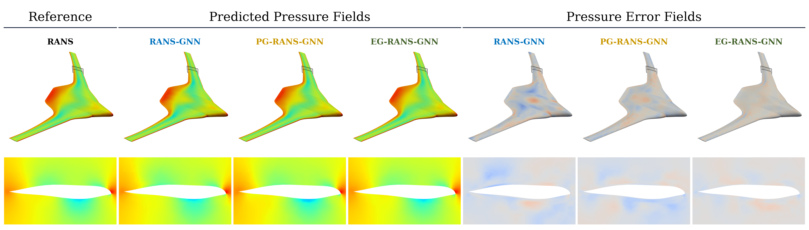
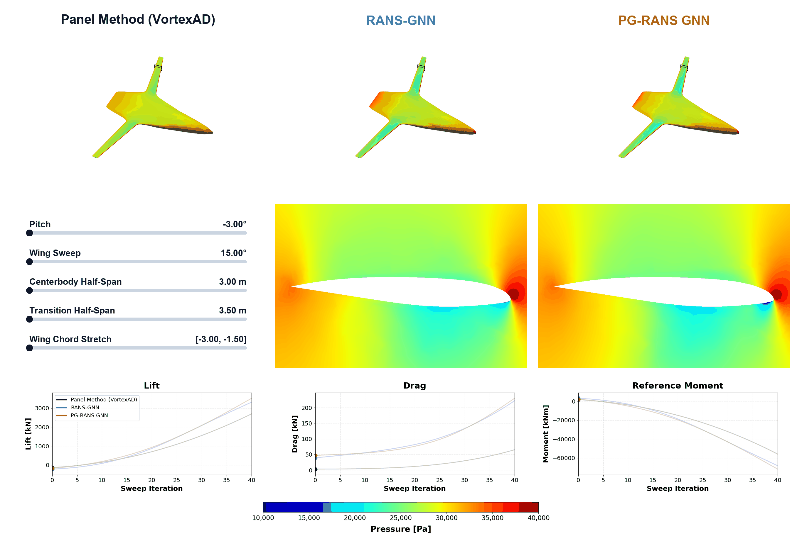

# AeroDML

AeroDML (Aerodynamic Deep Multifidelity Learning) uses graph neural networks
to predict three-dimensional aerodynamic flow fields for aircraft design.
Evaluating high-fidelity CFD models and their derivatives can be a major cost in multidisciplinary design optimization,
where many aerodynamic evaluations are needed. Predicting the field quantities are also often necessary for tasks such as transferring aerodynamic loads to a structural model.

The repository investigates a multifidelity deep learning approach which combines lower-cost aerodynamic solvers with GNNs trained on high-fidelity RANS training data. A panel-method or Euler solution provides an
approximate flow field, and the GNN learns a nonlinear correction toward RANS. In the study on a blended-wing-body (BWB) aircraft configuration included in this code, this approach improved prediction accuracy compared to single-fidelity GNN while reducing evaluation time signficantly compared to CFD. The models were trained on 110 CFD fields with 3 sample test fields included in this repository.

*Surface and cross-section pressure predictions and errors for the single-fidelity, panel-guided, and Euler-guided GNN models compared with RANS for a sample test case.*

*Geometry sweeps showing predicted surface pressure fields, cross sections, and aerodynamic coefficients across Panel Method (VortexAD), RANS-GNN, and PG-RANS GNN models.*

This application was developed for high-performance computing (HPC) use on a
blended-wing-body configuration. It includes parallel CFD data generation,
GPU training and evaluation, and gradient-based optimization examples. It can
be modified for other configurations by adapting the geometry parameterization,
reference meshes, and data-generation setup.

The repository includes:

- **[Package and model](package.md):** the `aerodml` Python package for building
  mesh-based graphs, defining the GNN, and evaluating flow predictions.
- **[Data generation and training](training.md):** scripts for generating RANS
  CFD data, adding optional panel or Euler solutions, and training the models.
- **[Optimization](mdo.md):** aerodynamic and multidisciplinary design
  optimization examples using the trained models.

## Main workflow

1. **Generate data.** Sample geometry and flow conditions, deform a reference
   mesh, and run CFD. Add low-fidelity solutions for multifidelity training.
2. **Train.** Build the graph and train a GNN against the RANS flow fields.
3. **Analyze.** Compare predicted fields, lift, and drag with reference results.
4. **Optimize.** Use the trained model in a differentiable design workflow.
