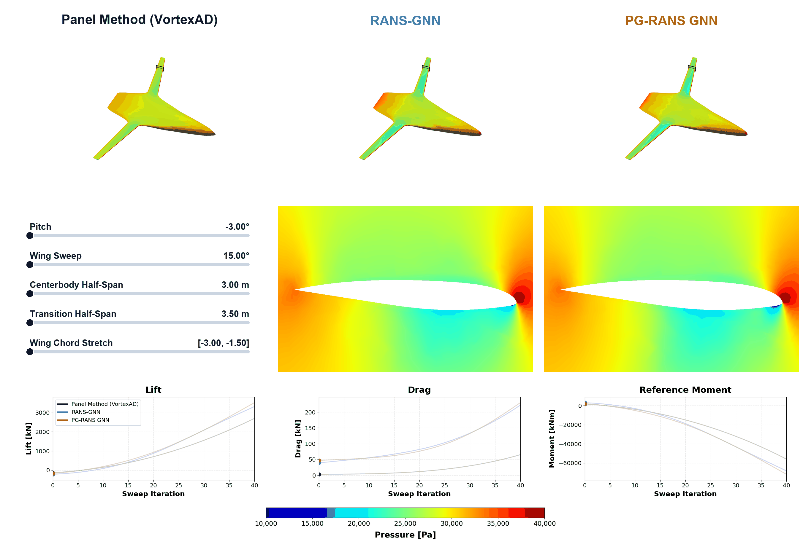

# Optimization

The BWB examples use aerodynamic predictions in gradient-based design
optimization. `bwb_camber_opt.py` adjusts wing twist and camber to reduce cruise
drag. `bwb_mdo.py` couples aerodynamics, beam structures, and mission
calculations in a multidisciplinary design optimization (MDO) problem.



*Model comparison during geometry variations.*

## Software

Install [AeroDML and the matching release assets](package.md#installation),
then set up the additional packages used by the optimization examples:

- `csdl_alpha`, `lsdo_geo`, and `lsdo_function_spaces` for differentiable models
  and geometry.
- `modopt` and `pyslsqp` for optimization.
- `VortexAD`, `aframe`, and `aeroelastic_coupling_utils` for panel aerodynamics,
  structures, and load transfer.
- `meshio` for mesh handling, plus CUDA-enabled JAX for GPU runs.

These dependencies are separate from the core package. The README in
`cases/aircraft_BWB/mdo/mdo_problems/` records the development environment and
required source interfaces; some packages used local changes, so the recorded
versions alone do not reproduce that environment.

## Workflow

1. **Choose the problem and aerodynamic model.** Both examples accept `Panel`,
   `RANS-GNN`, or `PG-RANS-GNN`. The GNN options load their matching trained weights.
2. **Review the design setup.** Set design variables, bounds, objectives, and
   constraints in the chosen script. Keep the examples in the repository so
   their relative geometry, mesh, and model paths resolve correctly.
3. **Run the optimization.** Each iteration updates the geometry, evaluates
   aerodynamics and any coupled models, and computes derivatives for the
   optimizer. The GNN predicts flow fields from which forces are reconstructed.
4. **Inspect the result.** Review the optimization history, geometry, and flow
   predictions. Re-evaluate the final design with RANS CFD to assess accuracy.

From `cases/aircraft_BWB/mdo/mdo_problems/`, in a suitable GPU allocation:

```bash
python bwb_mdo.py Panel
python bwb_camber_opt.py PG-RANS-GNN
```

Run one optimization at a time. To plot a completed run's history:

```bash
python make_visualizations_post_workshop.py RUN.hdf5 --histories-only
```

Euler-guided prediction is available for analysis, but is not included in these
optimization examples because the current workflow does not provide derivatives
through the Euler solver.

## Tested Environment Snapshot for Geometry Sweep Visualization

The geometry sweep visualization scripts (`cases/aircraft_BWB/mdo/visualize_sweeps/generate_sweep_gifs.py`) was generated with the environment below.

> **Note:** This snapshot is documented for running the geometry sweep and it is **not** the environment used for full MDO optimizations, which were run on an older environment with JAX `0.5.0`.

- **Python Version:** `3.11.18`

### LSDOlab Packages

- **csdl_alpha**
    - **URL:** [https://github.com/LSDOlab/csdl_alpha.git](https://github.com/LSDOlab/csdl_alpha.git)
    - **Branch:** `main`
    - **Commit:** `d4bf50ec91e722673b31849c4dfdad4c3076c715` (2026-10-09 14:57:44 -0700)
- **lsdo_function_spaces**
    - **URL:** [https://github.com/LSDOlab/lsdo_function_spaces.git](https://github.com/LSDOlab/lsdo_function_spaces.git)
    - **Branch:** `main`
    - **Commit:** `1cc4c4bf4bd026a4e0337f5dfbd725cb61423822` (2026-11-11 00:39:30 -0800)
- **lsdo_geo**
    - **URL:** [https://github.com/LSDOlab/lsdo_geo.git](https://github.com/LSDOlab/lsdo_geo.git)
    - **Branch:** `main`
    - **Commit:** `7e7271f8e9bf78578dc023993f64fa5b8e51ae6b` (2026-11-11 17:06:16 -0800)
- **VortexAD**
    - **URL:** [https://github.com/LSDOlab/VortexAD.git](https://github.com/LSDOlab/VortexAD.git)
    - **Branch:** `main`
    - **Commit:** `f8df3414b06a54c5f3f1bdb7c43333636015d964` (2026-11-11 13:47:58 -0800)
- **idwarp-jax**
    - **URL:** [https://github.com/LSDOlab/idwarp-jax.git](https://github.com/LSDOlab/idwarp-jax.git)
    - **Branch:** `main`
    - **Commit:** `38cd24cfb46034da609a873cd459328f058c6d41` (2026-11-11 18:51:00 -0800)

### PyPI Packages

The tested non-editable PyPI packages and their installed versions:

| Package | Version |
| :--- | :--- |
| `absl-py` | 2.5.1 |
| `attrs` | 26.1.0 |
| `certifi` | 2026.10.23 |
| `charset-normalizer` | 3.5.2 |
| `cloudpickle` | 3.1.2 |
| `contourpy` | 1.3.3 |
| `cycler` | 0.12.1 |
| `cyclopts` | 5.4.0 |
| `docstring_parser` | 0.18.0 |
| `fonttools` | 4.68.0 |
| `h5py` | 3.16.0 |
| `idna` | 3.20 |
| `iniconfig` | 2.3.1 |
| `jax` | 0.10.2 |
| `jax-cuda12-pjrt` | 0.10.2 |
| `jax-cuda12-plugin` | 0.10.2 |
| `jaxlib` | 0.10.2 |
| `joblib` | 1.6.0 |
| `kiwisolver` | 1.5.1 |
| `markdown-it-py` | 4.3.0 |
| `matplotlib` | 3.11.2 |
| `mdurl` | 0.1.2 |
| `meshio` | 5.3.5 |
| `ml_dtypes` | 0.6.0 |
| `mpmath` | 1.3.0 |
| `narwhals` | 2.28.0 |
| `networkx` | 3.6.1 |
| `numpy` | 2.4.6 |
| `nvidia-cublas-cu12` | 12.9.3.13 |
| `nvidia-cuda-cccl-cu12` | 12.9.27 |
| `nvidia-cuda-cupti-cu12` | 12.9.79 |
| `nvidia-cuda-nvcc-cu12` | 12.9.86 |
| `nvidia-cuda-nvrtc-cu12` | 12.9.86 |
| `nvidia-cuda-runtime-cu12` | 12.9.79 |
| `nvidia-cudnn-cu12` | 9.28.1.4 |
| `nvidia-cufft-cu12` | 11.4.1.4 |
| `nvidia-cusolver-cu12` | 11.7.5.82 |
| `nvidia-cusparse-cu12` | 12.5.10.65 |
| `nvidia-nccl-cu12` | 2.32.3 |
| `nvidia-nvjitlink-cu12` | 12.9.86 |
| `nvidia-nvshmem-cu12` | 3.8.0 |
| `Ofpp` | 0.12 |
| `opt_einsum` | 3.4.0 |
| `optax` | 0.2.8 |
| `packaging` | 26.3 |
| `pandas` | 3.1.1 |
| `pillow` | 13.0.0 |
| `pip` | 26.2.2 |
| `platformdirs` | 4.14.5 |
| `pluggy` | 1.7.0 |
| `pooch` | 1.9.0 |
| `pydot` | 4.0.1 |
| `Pygments` | 2.21.0 |
| `pyparsing` | 3.3.3 |
| `pytest` | 9.2.0 |
| `python-dateutil` | 4.0.0 |
| `pyvista` | 0.49.2 |
| `pyvista-validation` | 0.2.2 |
| `requests` | 2.34.2 |
| `rich` | 15.0.0 |
| `rich-rst` | 2.2.0 |
| `rustworkx` | 0.18.1 |
| `scikit-learn` | 1.9.1 |
| `scipy` | 1.17.1 |
| `scooby` | 0.12.1 |
| `setuptools` | 84.2.1 |
| `sympy` | 1.14.0 |
| `threadpoolctl` | 3.8.0 |
| `typing_extensions` | 4.16.0 |
| `tzdata` | 2026.6 |
| `urllib3` | 2.8.0 |
| `vedo` | 2026.6.3 |
| `vtk` | 9.7.2 |
| `wheel` | 0.48.0 |
